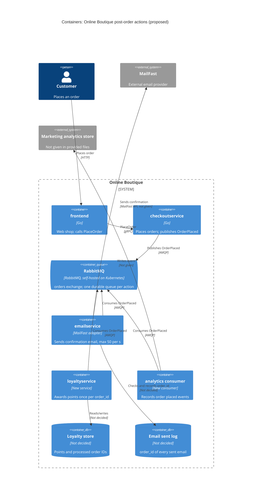

# ADR-0002: Use RabbitMQ order events for post-order actions

- **Status:** Proposed
- **Date:** 2026-10-25
- **Deciders:** Thanabul Parodom (architect), for approval by the architecture review board

> Based on the AI draft `exercise/outputs/2b-adr.md`. The architect reviewed it, corrected it and made the decisions on email delay and duplicate emails; see the change table in `exercise/02-write-adr.en.md`.

## Context and problem

Requirement R-12 (`docs/scenario.md`) adds three post-order actions: send the confirmation email through **MailFast** (an external provider that replaces the mock `emailservice` logic), award **loyalty points** through a new `loyaltyservice`, and record an **"order placed" analytics event**. Marketing expects **more post-order actions next year** (SMS, fraud scoring, a recommendations update).

How checkout works today (evidence from `system/online-boutique/src/checkoutservice/main.go`):

| Fact | Evidence |
|---|---|
| `PlaceOrder` makes all its calls synchronously over gRPC, one after another, in the request path | `PlaceOrder` (lines 230-280); gRPC client connections in `checkoutService` struct (lines 66-86) |
| The card is charged **before** shipping and email; a payment error fails the order | `cs.chargeCard` (lines 252-255) |
| A shipping error fails the order, even though the card has already been charged | `cs.shipOrder` (lines 258-261) |
| An email failure only logs a warning, and the order still succeeds | `sendOrderConfirmation` call (lines 273-277) |
| The email call is a plain gRPC call with no timeout of its own; it uses the caller's context | `sendOrderConfirmation` (lines 379-384), `EMAIL_SERVICE_ADDR` (line 115) |
| A unique order ID is created per order and can serve as an idempotency key | `uuid.NewUUID()` (line 233), `OrderResult.OrderId` (line 266) |
| The order total is computed in the user's currency, but it is not part of `OrderResult` | lines 243-250 vs. lines 265-271 |
| `checkoutservice` has no database or other durable store of its own | `checkoutService` struct (lines 66-86) holds only gRPC connections |
| Trace context is propagated over gRPC with OpenTelemetry | lines 134-140, 214-216 |

Quality goals and constraints (`docs/scenario.md`, *Quality goals and constraints*):

| Topic | Fact |
|---|---|
| Checkout latency | `PlaceOrder` p95 **≤ 500 ms** (today approximately 300 ms, so approximately 200 ms headroom) |
| Peak load | **200 orders/s** (11.11 sale) |
| MailFast | p95 **1.5 s**, p99 **8 s**, approximately **0.5 %** failed calls, rate limit **50 emails/s** |
| Loyalty points | **within 1 minute**, **exactly once** |
| Availability | an order must **never fail** because email, loyalty or analytics is down |
| Team | 4 developers, strong in Go and gRPC; two have used **RabbitMQ** |
| Operations | Kubernetes; prefer **open-source, self-hosted** over cloud-only managed services |

**The problem:** if MailFast is called inside `PlaceOrder`, the checkout latency goal fails, because MailFast's p95 alone (1.5 s) is three times the 500 ms budget. The throughput does not fit either: at 200 orders/s against a 50 emails/s limit, 150 emails/s (75 %) would be rejected at peak. Loyalty points need a guarantee (within 1 minute, exactly once) that today's best-effort "log a warning" approach cannot give. Every new post-order action would also mean another change to `checkoutservice`. We must decide **how `checkoutservice` triggers post-order actions**.

## Decision drivers

1. **Availability:** an order must never fail because email, loyalty or analytics is down.
2. **Performance:** `PlaceOrder` p95 ≤ 500 ms at 200 orders/s; MailFast (p95 1.5 s, p99 8 s) must not be in the request path.
3. **Reliability of loyalty points:** awarded within 1 minute and exactly once per order.
4. **Throughput mismatch and failures:** 200 orders/s against MailFast's 50 emails/s; about 0.5 % of calls fail and need retries.
5. **Modifiability:** add SMS, fraud scoring and recommendations next year without changing `checkoutservice` each time.
6. **Team fit and operability:** 4 Go/gRPC developers (two know RabbitMQ), Kubernetes, open-source and self-hosted.

## Considered options

1. **Synchronous orchestration:** `checkoutservice` calls the email adapter, `loyaltyservice` and analytics over gRPC inside `PlaceOrder`, as it calls `emailservice` today
2. **In-process asynchronous calls:** `checkoutservice` returns the response, then calls the same services from background goroutines, with in-memory retries
3. **Event via RabbitMQ (self-hosted):** `checkoutservice` publishes one `OrderPlaced` event to an exchange; each action has its own durable queue and consumer
4. **Event log via Apache Kafka (self-hosted):** `checkoutservice` writes `OrderPlaced` to a topic; each action is a consumer group

Managed cloud brokers (e.g. a cloud pub/sub service) are not considered, because the company prefers open-source, self-hosted components (`docs/scenario.md`).

### Pros and cons of the options

| Option | Pros | Cons |
|---|---|---|
| 1. Synchronous gRPC | No new infrastructure; the team is strong in gRPC; the result of each action is known immediately | MailFast p95 1.5 s breaks the 500 ms goal, and a short timeout would drop many emails; at peak, 75 % of emails exceed the 50/s limit; a failed loyalty call is lost, so neither "within 1 minute" nor "exactly once" is met; every new action changes `checkoutservice`; checkout latency grows with each action |
| 2. In-process async | No new infrastructure; email latency leaves the request path; quick to build in Go | Work held in memory is lost when a pod restarts, is rescheduled or scales down, so loyalty points can be lost; the 50/s limit must be shared across `checkoutservice` replicas, which needs coordination; at peak the backlog (150 emails/s) piles up in checkout pods' memory; each new action is still a `checkoutservice` change |
| 3. RabbitMQ events | Only a fast publish stays in the request path **[Inferred: few ms in-cluster, to be measured]**; durable queues keep messages while consumers or MailFast are down; the email consumer can be throttled to ≤ 50/s, and the backlog waits in the queue; built-in acks, retries and dead-letter queues; a separate queue per action, so an email backlog never delays loyalty; a new action needs only a new queue and consumer; open source, runs on Kubernetes; two developers already know it | A new stateful component to run (cluster, upgrades, monitoring); `checkoutservice` now depends on the broker; delivery is at least once, so consumers must be idempotent; email becomes eventually consistent (delayed at peak); messages are deleted after they are consumed, so there is no built-in history to replay |
| 4. Kafka event log | Retained log: analytics and next year's consumers can replay history; very high throughput; open source, self-hosted | No team experience; heavier operations (several brokers and their metadata quorum); per-message retry, delay and dead-letter handling must be built by hand; a consumer limited to 50/s must be built by hand; its very high throughput is far more than the 200 events/s we need |

## Decision

Choose **option 3: publish an `OrderPlaced` event to a self-hosted RabbitMQ**, with one durable queue per post-order action. It is the only option that keeps MailFast out of the checkout path (drivers 1 and 2), can retry and deduplicate work so that loyalty points are effectively exactly once (driver 3), and buffers peak traffic down to MailFast's rate limit (driver 4). It also lets new actions subscribe without touching `checkoutservice` (driver 5), and it matches the team's skills and the self-hosting preference (driver 6). Kafka would also work, but it adds operating effort and custom retry code that this load does not justify. Its replay advantage only matters if marketing needs history (see Open questions).

How it works:

- **Publisher (`checkoutservice`):** replace the synchronous `sendOrderConfirmation` call (`main.go` lines 273-277) with a persistent publish of `OrderPlaced`, using publisher confirms, to a durable `orders` exchange. The event carries `order_id` (line 233), `user_id`, `email`, items, shipping data and the order **total** (lines 243-250, which `OrderResult` does not include today). Payment and shipping stay synchronous, unchanged.
- **Queues:** `email.order-confirmation`, `loyalty.award-points` and `analytics.order-placed` are bound to `orders`. Each is a replicated (quorum) queue with its own dead-letter queue.
- **`emailservice`:** its logic is replaced by a MailFast adapter that consumes `email.order-confirmation`. It is throttled to **≤ 50 emails/s in total across all replicas**, retries failures with backoff and sends a message to the dead-letter queue after N attempts (N is to be agreed). At 50/s with up to 1.5 s per call, it needs roughly 75 or more calls in flight at once (Little's law, using p95 as a conservative mean).
- **Email delay at peak is accepted.** During the 11.11 peak, confirmation emails are delayed by several minutes, and we accept this rather than make MailFast a blocker: an email is not needed to complete an order, and the order itself still succeeds. The order confirmation page tells the customer that the confirmation email may take a few minutes. We alert on queue depth and on the age of the oldest message in `email.order-confirmation`.
- **No duplicate confirmation emails.** `emailservice` records the `order_id` of every email it has sent in a small store, and skips a message whose `order_id` is already recorded. If MailFast supports an idempotency key, we also send `order_id` as that key, to cover a crash between the MailFast call and the record.
- **`loyaltyservice` (new):** consumes `loyalty.award-points` and awards points **idempotently**. It stores the processed `order_id` under a unique constraint in the same transaction as the points update. It acks the message only after commit. Together, "at least once" delivery plus deduplication gives "exactly once" points per order.
- **Analytics consumer:** consumes `analytics.order-placed` and writes the event to marketing's store, which is not given in the provided files.
- **Tracing:** put the OpenTelemetry trace context into the AMQP message headers, the same way it already flows over gRPC (lines 134-140).
- **If the broker is unavailable:** `PlaceOrder` retries the publish briefly, within the latency headroom. If it still fails, it does **not** fail the order (the card is already charged, line 252). Instead it logs the full event at error level so it can be replayed. This keeps today's behaviour for email failures (lines 273-277).

## Consequences

- **Positive:** MailFast latency (p95 1.5 s, p99 8 s) leaves the request path; `PlaceOrder` no longer waits for email at all, so the 500 ms goal is kept (quality attribute: performance).
- **Positive:** when email, loyalty, analytics or MailFast is down, orders still succeed, and the messages wait in durable queues until the consumer recovers (quality attribute: availability).
- **Positive:** peak load is absorbed. The email consumer drains at 50/s and never goes over MailFast's limit, while loyalty and analytics keep up on their own queues (quality attribute: scalability, resilience).
- **Positive:** loyalty points arrive within the 1-minute target and exactly once per `order_id`, through idempotent processing (quality attribute: reliability, correctness).
- **Positive:** SMS, fraud scoring (if it can run after the order) and the recommendations update each become one new queue and consumer, with no change to `checkoutservice` (quality attribute: modifiability).
- **Positive:** open source, self-hosted on the existing Kubernetes, and known to two developers (quality attribute: cost, operability).
- **Negative:** a new stateful cluster that must be sized, monitored, upgraded and backed up (quality attribute: operability, cost).
- **Negative (accepted):** confirmation emails are delayed at peak. At 200 orders/s in and 50/s out, the backlog grows by 150 emails/s, or **9,000 per minute of peak**, so an email queued after 1 minute of peak waits about 3 minutes (9,000 / 50 = 180 s). We accept this delay and tell the customer on the confirmation page (quality attribute: usability, consistency).
- **Negative:** delivery is at least once, so every consumer must be idempotent. `emailservice` needs a small store of sent `order_id`s to avoid duplicate emails, which is one more component to run (quality attribute: correctness, operability).
- **Negative:** one order now spans asynchronous hops, which are harder to trace and debug unless trace context is carried in message headers (quality attribute: observability, testability).
- **Negative:** customer email addresses and order data now sit in queues and dead-letter queues (quality attribute: security, privacy).
- **Risks and mitigations:**
  - *The broker is down when an order is placed (accepted risk for now):* the event could be lost after the card is charged. Mitigate with a 3-node RabbitMQ cluster and quorum queues, a bounded publish retry, and error logging plus a replay job. A transactional outbox would close the gap completely, but it needs a durable store in `checkoutservice`, which has none today (struct, lines 66-86). Leave that for a follow-up ADR.
  - *The email backlog during 11.11:* alert on queue depth and on the age of the oldest message; ask MailFast for a higher limit.
  - *Loyalty lag goes over 1 minute:* alert on the age of the oldest message in `loyalty.award-points`; scale `loyaltyservice` replicas. Its own queue is never blocked by email.
  - *Poison messages:* dead-letter them after N retries, alert, and replay manually.
  - *Duplicate orders from a client retrying `PlaceOrder`:* each retry creates a new `order_id` (line 233), so deduplication on `order_id` does not catch them. This is existing behaviour and is not addressed by this ADR.

## Validation

- **Load test** at 200 orders/s (e.g. with the Locust `loadgenerator`, as in ADR-0001), for the expected 11.11 peak duration: `PlaceOrder` p95 ≤ 500 ms; publish latency p95 reported separately.
- **MailFast stub** with p95 1.5 s, p99 8 s, 0.5 % errors and a 50/s limit: zero rate-limit rejections; every email is either sent or in the dead-letter queue; measure how long the backlog takes to drain.
- **Duplicate email test:** redeliver the same `OrderPlaced` message to `emailservice`: exactly one email is sent per `order_id`.
- **Fault injection:** stop the email, loyalty and analytics consumers and the MailFast stub during load: **0 failed orders**.
- **Loyalty:** order-to-points lag p99 ≤ 60 s at 200 orders/s; kill `loyaltyservice` before it acks, to force redelivery: exactly one award per `order_id`; reconcile the count of published `OrderPlaced` events against points awards, with 0 mismatches.
- **Broker failover:** kill one RabbitMQ node under load: no lost messages, no failed orders.
- **Review date:** after the first 11.11 sale on this design, and before the first new post-order consumer is added.

## Open questions

1. **Peak duration:** how long does 200 orders/s last during 11.11? The backlog grows by 9,000 emails per minute of peak, so this sets the longest email delay that customers will see.
2. **MailFast details:** does MailFast accept an idempotency key (we use `order_id` if it does)? What are its API, timeout guidance and rate-limit error response?
3. **Loyalty rules:** how many points per order, and in which currency (the total is in the user's currency, line 243)? What identifies a loyalty member? What `req.UserId` represents is not evidenced in the provided files.
4. **Broker outage policy:** is losing an event (and so its points) during a broker outage acceptable, or should we add a store to `checkoutservice` for a transactional outbox?
5. **Analytics:** which store, which fields, how long to keep the data, and does marketing need to replay history? A need to replay would favour option 4.
6. **Fraud scoring:** must it block an order before payment? If so, it is synchronous and does not fit this after-order event flow.
7. **Operations:** who runs RabbitMQ on Kubernetes (operator, sizing, backups), and what is the budget?
8. **New services:** language and data store for `loyaltyservice` and the analytics consumer (Go fits the team, but this is not decided), and the retry limit N.
9. **Privacy:** retention and protection rules for customer email addresses in queues.
10. **Email sent log:** which store `emailservice` uses for sent `order_id`s, and how long to keep them.
