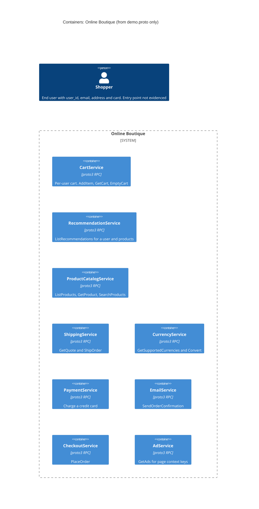

# 1A: Recovered architecture (C4 container level)

Run: **A** · Evidence: `system/online-boutique/protos/demo.proto` only

## 1. Agent

Claude (Anthropic), running as a fresh agent session; model: claude-opus-5-5 (as configured)

## 2. Files read

Evidence (the only file used for architectural claims):

- `system/online-boutique/protos/demo.proto`

Instructions only (read because the rules require it, not used as architectural evidence):

- `AGENTS.md`
- `CLAUDE.md`
- `prompts/1-recover-architecture.md`

No other files or folders were opened, listed or searched.

## 3. Containers table

Notes that apply to every row:

- The file defines 9 RPC `service` interfaces in package `hipstershop` (`demo.proto` L17), written in Protocol Buffers `proto3` (L15). Transport is taken to be gRPC because `service`/`rpc` is the gRPC IDL form, but the file never names gRPC: **[Inferred]**.
- Implementation language: Not evidenced in the provided files. `option go_package` (L19) only says where Go stubs are generated.
- Each `service` is listed as one container. The file does not show that each one is deployed on its own (see Gaps).
- Data stores: none. Not evidenced in the provided files.

| Container | Technology / language | Responsibility (from its RPCs) | Evidence |
|---|---|---|---|
| CartService | proto3 RPC (gRPC [Inferred]); language not evidenced | Per-user shopping cart: `AddItem`, `GetCart`, `EmptyCart`, keyed by `user_id` | `system/online-boutique/protos/demo.proto` (`service CartService`, L23–27) |
| RecommendationService | proto3 RPC (gRPC [Inferred]); language not evidenced | `ListRecommendations`: returns product IDs for a user and a list of products | `system/online-boutique/protos/demo.proto` (`service RecommendationService`, L56–58) |
| ProductCatalogService | proto3 RPC (gRPC [Inferred]); language not evidenced | Product catalogue: `ListProducts`, `GetProduct`, `SearchProducts` (product has a USD price, picture, categories) | `system/online-boutique/protos/demo.proto` (`service ProductCatalogService`, L71–75; `message Product`, L77–87) |
| ShippingService | proto3 RPC (gRPC [Inferred]); language not evidenced | `GetQuote` (shipping cost in USD) and `ShipOrder` (returns `tracking_id`) for an address and cart items | `system/online-boutique/protos/demo.proto` (`service ShippingService`, L107–110) |
| CurrencyService | proto3 RPC (gRPC [Inferred]); language not evidenced | `GetSupportedCurrencies` and `Convert` `Money` to an ISO 4217 code | `system/online-boutique/protos/demo.proto` (`service CurrencyService`, L140–143) |
| PaymentService | proto3 RPC (gRPC [Inferred]); language not evidenced | `Charge` an amount to a credit card, returns `transaction_id` | `system/online-boutique/protos/demo.proto` (`service PaymentService`, L177–179; `CreditCardInfo`, L181–186) |
| EmailService | proto3 RPC (gRPC [Inferred]); language not evidenced | `SendOrderConfirmation` to an email address for an `OrderResult` | `system/online-boutique/protos/demo.proto` (`service EmailService`, L199–201) |
| CheckoutService | proto3 RPC (gRPC [Inferred]); language not evidenced | `PlaceOrder` from user ID, currency, address, email and card. Returns `OrderResult` (order ID, tracking ID, shipping cost, items) | `system/online-boutique/protos/demo.proto` (`service CheckoutService`, L224–226; `PlaceOrderRequest`, L228–235) |
| AdService | proto3 RPC (gRPC [Inferred]); language not evidenced | `GetAds` for page context keywords, returns ad text and redirect URL | `system/online-boutique/protos/demo.proto` (`service AdService`, L243–245) |

End user (not a container): the shopper. The evidence is the user-related fields `user_id`, `email` and `credit_card` in `PlaceOrderRequest` (`demo.proto` L229, L233, L234). The file does not show which container the user talks to.

## 4. Dependencies table

| Caller → callee | Protocol | Evidence |
|---|---|---|
| None | None | Not evidenced in the provided files. `demo.proto` says what each service **offers**. It never says who **calls** it: there are no client addresses, imports or call sites. |

What the file does show is build-time contract coupling, which is not a runtime dependency. All 9 services share one package (`hipstershop`, L17) and reuse the same message types. For example, `Money` (L146) appears in `Product.price_usd` (L82), `GetQuoteResponse.cost_usd` (L118), `ChargeRequest.amount` (L189) and `OrderItem.cost` (L205). `CartItem` (L29) and `Address` (L130) are shared too. Candidate runtime dependencies are listed under Gaps.

## 5. Mermaid diagram

There are no `Rel` lines because the Dependencies table has no evidenced rows. The `Person` has no `Rel` because the entry point is not evidenced.

## 6. Gaps

### 6.1 Not determinable from `demo.proto`

| Gap | Why the evidence can't settle it | File(s) that would settle it |
|---|---|---|
| All runtime dependencies (who calls whom) | A proto declares servers, not clients | Kubernetes manifests: service-address env vars. AGENTS.md's formatting example cites `system/online-boutique/kubernetes-manifests/frontend.yaml (CART_SERVICE_ADDR)`. Not used as evidence here. Also each service's source code. |
| Entry point for the end user (UI / web frontend / gateway) | No UI or frontend `service` is defined in the proto | Kubernetes manifests, e.g. the `frontend.yaml` named in AGENTS.md's example. Not used as evidence here. |
| Whether each proto `service` is its own deployable container, and what it is called when deployed | One process could implement several interfaces | Kubernetes manifests (one Deployment/Service per container) |
| Implementation language / runtime per service | `go_package` (L19) only sets the Go stub path | Each service's source folder or Dockerfile (path not known from the allowed evidence) |
| Transport details: gRPC confirmed, ports, TLS | The file only defines the IDL. gRPC is **[Inferred]** | Manifests (ports) and service source (server set-up) |
| Data stores | Cart state keyed by `user_id` (L40, L44, L48) has to live somewhere. Where catalogue data (L77–87) and ads (L256–262) come from is not shown | Cart service source/config and manifests (e.g. a database or cache deployment) |
| External systems | `PaymentService` receives full card data (L181–186). Whether it calls an outside payment provider is not shown. Whether `EmailService` uses an outside mail provider is not shown. Hosts for `Product.picture` (L81) and `Ad.redirect_url` (L258) are not shown | Payment and email service source code |
| Asynchronous messaging / message broker | Nothing in the proto shows any. Not evidenced either way | Manifests and service source |

### 6.2 Candidate dependencies (**[Inferred]**, not in the diagram)

These come only from how the message types line up. None of them is a proven call.

| Candidate (caller → callee) | Reasoning from `demo.proto` | Would be confirmed by |
|---|---|---|
| CheckoutService → CartService | `PlaceOrderRequest` has `user_id` (L229) but no items. `Cart` is keyed by `user_id` (L43–50). `EmptyCart` (L26) fits clean-up after an order | Checkout source / manifest env vars |
| CheckoutService → ProductCatalogService | `CartItem` has only `product_id` (L30). `OrderItem.cost` (L205) needs a price, which `Product.price_usd` (L82) provides | Checkout source / manifest env vars |
| CheckoutService → CurrencyService | `PlaceOrderRequest.user_currency` (L230). Prices and shipping cost are in USD (L82, L118). `Convert` (L142) | Checkout source / manifest env vars |
| CheckoutService → ShippingService | `PlaceOrderRequest.address` (L232). `OrderResult.shipping_cost` / `shipping_tracking_id` (L210–211) match `GetQuoteResponse.cost_usd` (L118) / `ShipOrderResponse.tracking_id` (L127) | Checkout source / manifest env vars |
| CheckoutService → PaymentService | `PlaceOrderRequest.credit_card` is `CreditCardInfo` (L234), the same type that `ChargeRequest` takes (L190) | Checkout source / manifest env vars |
| CheckoutService → EmailService | `PlaceOrderRequest.email` (L233). `SendOrderConfirmationRequest` takes `email` plus `OrderResult` (L216–219), and `OrderResult` is exactly what `PlaceOrderResponse` returns (L238) | Checkout source / manifest env vars |
| RecommendationService → ProductCatalogService (weak) | Returns `product_ids` (L66), so it needs some source of candidate products. That source could be local | Recommendation source / manifest env vars |
| Unknown UI caller → CartService, ProductCatalogService, RecommendationService, AdService, CurrencyService, ShippingService (`GetQuote`), CheckoutService | These RPCs look user-facing (e.g. `AddItem` L24, `SearchProducts` L74, `GetAds` L244, `PlaceOrder` L225), but no caller is defined | Frontend/UI manifest and source |
