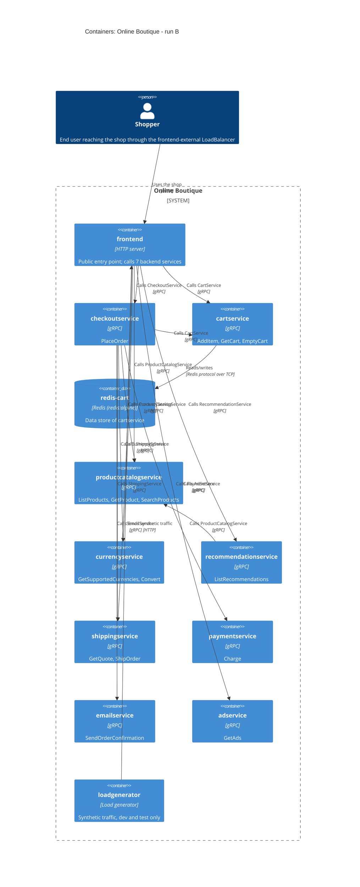

# 1B: Recovered architecture (C4 container level)

Inputs: `run: B` · `evidence: system/online-boutique/protos/demo.proto, system/online-boutique/kubernetes-manifests/`

## 1. Agent

Claude (Anthropic), running as a fresh agent session; model: claude-opus-5-5 (as configured)

## 2. Files read

Task setup (not used as architectural evidence):

- `AGENTS.md`
- `CLAUDE.md` (loaded automatically by the agent harness; it only points to `AGENTS.md`)
- `prompts/1-recover-architecture.md`

Evidence (all architectural claims below come from these files only):

- `system/online-boutique/protos/demo.proto`
- `system/online-boutique/kubernetes-manifests/` (listed the folder, which has no subfolders, then read all 13 files):
  - `README.md`
  - `kustomization.yaml`
  - `adservice.yaml`
  - `cartservice.yaml`
  - `checkoutservice.yaml`
  - `currencyservice.yaml`
  - `emailservice.yaml`
  - `frontend.yaml`
  - `loadgenerator.yaml`
  - `paymentservice.yaml`
  - `productcatalogservice.yaml`
  - `recommendationservice.yaml`
  - `shippingservice.yaml`

Paths below are shortened: `k8s/` = `system/online-boutique/kubernetes-manifests/`, `demo.proto` = `system/online-boutique/protos/demo.proto`.

## 3. Containers table

Applies to every row: each container is a Kubernetes `Deployment`. Every row except `loadgenerator` also has a `ClusterIP` `Service`. Images are bare names such as `image: frontend`, and `k8s/README.md` says skaffold inserts the real tags. So **implementation languages are Not evidenced in the provided files**.

| Container | Technology / language | Responsibility | Evidence |
|---|---|---|---|
| `frontend` | HTTP server on container port 8080. Service `frontend` :80→8080 (`ClusterIP`), Service `frontend-external` :80→8080 (`LoadBalancer`). Language not evidenced | The system's only externally exposed entry point. Holds addresses for 7 backend services. Serving the shop's web UI with a cookie-based session is **[Inferred]** from the `shop_session-id` cookie in its probes | `k8s/frontend.yaml` (Deployment `frontend`, `httpGet /_healthz` lines 50-65; Service `frontend-external` `type: LoadBalancer` lines 123-136). There is no `service` for it in `demo.proto` |
| `checkoutservice` | gRPC server :5050. Language not evidenced | Places an order: `PlaceOrder(user_id, user_currency, address, email, credit_card)` → `OrderResult`. Holds addresses for 6 services | `k8s/checkoutservice.yaml` (grpc probes lines 48-53, Service port `grpc` line 88); `demo.proto` `service CheckoutService` (lines 224-239) |
| `cartservice` | gRPC server :7070. Language not evidenced | Per-user shopping cart: `AddItem`, `GetCart`, `EmptyCart` | `k8s/cartservice.yaml` (grpc probes lines 59-67, Service port `grpc` line 80); `demo.proto` `service CartService` (lines 23-50) |
| `redis-cart` | Redis (`image: redis:alpine`), TCP :6379, `emptyDir` volume mounted at `/data` | Data store used by `cartservice`. That it holds cart contents is **[Inferred]** from its name | `k8s/cartservice.yaml` (Deployment `redis-cart` lines 89-141, `emptyDir` lines 139-141; Service `redis-cart` port `tcp-redis` lines 143-156) |
| `productcatalogservice` | gRPC server :3550. Language not evidenced | Product catalog: `ListProducts`, `GetProduct`, `SearchProducts`. A `Product` has id, name, description, picture, `price_usd`, categories | `k8s/productcatalogservice.yaml` (grpc probes lines 54-59, Service port `grpc` line 79); `demo.proto` `service ProductCatalogService` (lines 71-103) |
| `currencyservice` | gRPC server :7000. Language not evidenced | Lists supported currencies (`GetSupportedCurrencies`) and converts `Money` between ISO 4217 codes (`Convert`) | `k8s/currencyservice.yaml` (container port `grpc` line 48, probes lines 55-60); `demo.proto` `service CurrencyService` (lines 140-173) |
| `recommendationservice` | gRPC server :8080. Language not evidenced | `ListRecommendations(user_id, product_ids)` → `product_ids` | `k8s/recommendationservice.yaml` (grpc probes lines 49-56, Service port `grpc` line 83); `demo.proto` `service RecommendationService` (lines 56-67) |
| `shippingservice` | gRPC server :50051. Language not evidenced | Shipping quote (`GetQuote` → `cost_usd`) and shipping an order (`ShipOrder` → `tracking_id`) for an `Address` and items | `k8s/shippingservice.yaml` (grpc probes lines 53-59, Service port `grpc` line 79); `demo.proto` `service ShippingService` (lines 107-136) |
| `paymentservice` | gRPC server :50051. Language not evidenced | `Charge(amount, credit_card)` → `transaction_id` | `k8s/paymentservice.yaml` (grpc probes lines 54-59, Service port `grpc` line 79); `demo.proto` `service PaymentService` (lines 177-195) |
| `emailservice` | gRPC server. Service :5000 → container :8080. Language not evidenced | `SendOrderConfirmation(email, OrderResult)` | `k8s/emailservice.yaml` (grpc probes lines 54-61; Service port `grpc` 5000→8080 lines 81-83); `demo.proto` `service EmailService` (lines 199-219) |
| `adservice` | gRPC server :9555. Language not evidenced | `GetAds(context_keys)` → ads (`redirect_url`, `text`) | `k8s/adservice.yaml` (grpc probes lines 59-68, Service port `grpc` line 81); `demo.proto` `service AdService` (lines 243-262) |
| `loadgenerator` | Load-generating client (`image: loadgenerator`) plus a `busybox` init container. It has no Service and no port. Language/tool not evidenced | Sends synthetic traffic to `frontend` (`USERS=10`, `RATE=1`). Dev/test only: it is commented out of `kustomization.yaml` | `k8s/loadgenerator.yaml` (lines 14-94); `k8s/kustomization.yaml` line 24 (`# - loadgenerator.yaml # During development, the loadgenerator module inside skaffold.yaml will be used.`) |

No message broker (`ContainerQueue`) appears anywhere in the evidence. Every dependency below is synchronous request/response.

## 4. Dependencies table

How the gRPC protocol is evidenced for every gRPC row: in the callee's manifest, the only Service port is named `grpc` and the readiness/liveness probes are `grpc`. The callee's API is the matching `service` in `demo.proto`. **Which RPCs each caller actually uses is Not evidenced** (see Gaps).

| # | Caller → callee | Protocol | Evidence (file + symbol / env var) |
|---|---|---|---|
| 1 | Shopper (end user) → `frontend` | HTTP | `k8s/frontend.yaml` Service `frontend-external`, `type: LoadBalancer`, port `http` 80→8080 (lines 123-136) |
| 2 | `loadgenerator` → `frontend` | HTTP | `k8s/loadgenerator.yaml` `FRONTEND_ADDR=frontend:80` (lines 69-70, 82-83); `wget ... http://${FRONTEND_ADDR}` (line 49) |
| 3 | `frontend` → `productcatalogservice` | gRPC | `k8s/frontend.yaml` `PRODUCT_CATALOG_SERVICE_ADDR=productcatalogservice:3550` (lines 69-70); `demo.proto` `ProductCatalogService` |
| 4 | `frontend` → `currencyservice` | gRPC | `k8s/frontend.yaml` `CURRENCY_SERVICE_ADDR=currencyservice:7000` (lines 71-72); `demo.proto` `CurrencyService` |
| 5 | `frontend` → `cartservice` | gRPC | `k8s/frontend.yaml` `CART_SERVICE_ADDR=cartservice:7070` (lines 73-74); `demo.proto` `CartService` |
| 6 | `frontend` → `recommendationservice` | gRPC | `k8s/frontend.yaml` `RECOMMENDATION_SERVICE_ADDR=recommendationservice:8080` (lines 75-76); `demo.proto` `RecommendationService` |
| 7 | `frontend` → `shippingservice` | gRPC | `k8s/frontend.yaml` `SHIPPING_SERVICE_ADDR=shippingservice:50051` (lines 77-78); `demo.proto` `ShippingService` |
| 8 | `frontend` → `checkoutservice` | gRPC | `k8s/frontend.yaml` `CHECKOUT_SERVICE_ADDR=checkoutservice:5050` (lines 79-80); `demo.proto` `CheckoutService` |
| 9 | `frontend` → `adservice` | gRPC | `k8s/frontend.yaml` `AD_SERVICE_ADDR=adservice:9555` (lines 81-82); `demo.proto` `AdService` |
| 10 | `checkoutservice` → `productcatalogservice` | gRPC | `k8s/checkoutservice.yaml` `PRODUCT_CATALOG_SERVICE_ADDR=productcatalogservice:3550` (lines 57-58) |
| 11 | `checkoutservice` → `shippingservice` | gRPC | `k8s/checkoutservice.yaml` `SHIPPING_SERVICE_ADDR=shippingservice:50051` (lines 59-60) |
| 12 | `checkoutservice` → `paymentservice` | gRPC | `k8s/checkoutservice.yaml` `PAYMENT_SERVICE_ADDR=paymentservice:50051` (lines 61-62); `demo.proto` `PaymentService` |
| 13 | `checkoutservice` → `emailservice` | gRPC | `k8s/checkoutservice.yaml` `EMAIL_SERVICE_ADDR=emailservice:5000` (lines 63-64); `demo.proto` `EmailService` |
| 14 | `checkoutservice` → `currencyservice` | gRPC | `k8s/checkoutservice.yaml` `CURRENCY_SERVICE_ADDR=currencyservice:7000` (lines 65-66) |
| 15 | `checkoutservice` → `cartservice` | gRPC | `k8s/checkoutservice.yaml` `CART_SERVICE_ADDR=cartservice:7070` (lines 67-68) |
| 16 | `recommendationservice` → `productcatalogservice` | gRPC | `k8s/recommendationservice.yaml` `PRODUCT_CATALOG_SERVICE_ADDR=productcatalogservice:3550` (lines 60-61) |
| 17 | `cartservice` → `redis-cart` | Redis protocol over TCP | `k8s/cartservice.yaml` `REDIS_ADDR=redis-cart:6379` (lines 50-51); Service `redis-cart` port `tcp-redis` (line 154); `image: redis:alpine` (line 118) |

Observations that come straight from the tables:

- `frontend` is the only container with an external `LoadBalancer`. Every backend Service is `ClusterIP` (internal only).
- `checkoutservice` has 6 outbound dependencies and `frontend` has 7. The other services have at most one: `recommendationservice` → `productcatalogservice` and `cartservice` → `redis-cart`. `adservice`, `currencyservice`, `shippingservice`, `paymentservice`, `emailservice` and `productcatalogservice` have no outbound address env vars.
- `redis-cart` is defined inside `cartservice.yaml`, and `cartservice` is its only client (`REDIS_ADDR` appears in no other manifest).

## 5. Mermaid diagram

The diagram has no `System_Ext`, because no external system is evidenced (see Gaps).

## 6. Gaps

| # | What could not be determined | What the evidence shows | File that would settle it |
|---|---|---|---|
| 1 | **Language and framework of each service** | Images are bare names (`image: frontend`, etc.). `k8s/README.md` says skaffold inserts the tags. `demo.proto` line 19 has `option go_package`, which only shows Go code is generated from the proto, not which services are written in Go | Each service's source code / Dockerfile (location not shown in the evidence); `skaffold.yaml` (referenced in `k8s/kustomization.yaml` line 24) |
| 2 | **Which RPCs each caller uses, and in what order** (e.g. the steps inside `PlaceOrder`) | Env vars show only that a caller has the callee's address. **[Inferred]**: `checkoutservice` likely uses `GetCart`/`EmptyCart`, `GetProduct`, `Convert`, `GetQuote`/`ShipOrder`, `Charge` and `SendOrderConfirmation`, given `PlaceOrderRequest`/`OrderResult` fields in `demo.proto` (lines 203-239). This is not proven | Source code of `frontend`, `checkoutservice` and `recommendationservice` |
| 3 | **`shoppingassistantservice`** (left out of the diagram on purpose) | `k8s/frontend.yaml` sets `SHOPPING_ASSISTANT_SERVICE_ADDR=shoppingassistantservice:80` (lines 83-84). But no manifest in the folder deploys it, `ENABLE_ASSISTANT` is commented out (lines 93-94), the kustomize component is commented out (`k8s/kustomization.yaml` line 35), and `demo.proto` has no interface for it. Its protocol and whether it runs are Not evidenced | `system/online-boutique/kustomize/components/shopping-assistant/` (path from `kustomization.yaml` line 35, relative to `k8s/`); `frontend` source |
| 4 | **"Packaging service"** (optional) | Only a commented-out `PACKAGING_SERVICE_URL` in `k8s/frontend.yaml` (lines 97-99), described as part of "an optional Google Cloud demo". It is probably an external HTTP service **[Inferred]** from the `http://` example value | `frontend` source; the related Google Cloud demo docs |
| 5 | **External systems** (payment gateway, email/SMTP provider, exchange-rate source, ad network) | `paymentservice`, `emailservice`, `currencyservice` and `adservice` have no outbound address or credentials env vars. So no external system is evidenced, and none is drawn. Whether these services are real integrations or mocks is Not evidenced | Source code of those four services |
| 6 | **Where product, ad and recommendation data come from** | `productcatalogservice`, `adservice` and `recommendationservice` have no data-store env vars and no volumes. Not evidenced | Source code of those services |
| 7 | **Order persistence** | No order data store appears in any manifest. `PlaceOrderResponse` only returns an `OrderResult` (`demo.proto` lines 208-239). Whether orders are stored anywhere is Not evidenced | `checkoutservice` source |
| 8 | **Cart data durability, and alternative data stores** | `redis-cart` uses an `emptyDir` volume (`k8s/cartservice.yaml` lines 139-141), so its data lives only as long as the pod. The commented-out components `memorystore`, `alloydb` and `spanner` (`k8s/kustomization.yaml` lines 32, 34, 36) might replace `redis-cart` **[Inferred]** | `system/online-boutique/kustomize/components/{memorystore,alloydb,spanner}/` |
| 9 | **Real deployed images, and whether `loadgenerator` runs** | `k8s/README.md` says these manifests are not directly deployable and points to `/release`. `loadgenerator.yaml` is commented out of `kustomization.yaml` (line 24) | `release/` manifests (named in `k8s/README.md` line 7); `skaffold.yaml` |
| 10 | **Transport security, auth and network isolation** | No TLS settings on HTTP or gRPC. `frontend` and `loadgenerator` carry the annotation `sidecar.istio.io/rewriteAppHTTPProbers`, which suggests an optional Istio mesh (and possibly mTLS) **[Inferred]**. The `network-policies` component is commented out (`kustomization.yaml` line 33). HTTPS for end users is Not evidenced (port 80, `http` only) | `system/online-boutique/kustomize/components/network-policies/`; any Istio manifests (location not in evidence) |
| 11 | **User identity / authentication** | Requests carry `user_id` (e.g. `demo.proto` lines 35, 40, 44, 61, 229), and `frontend` probes send a `shop_session-id` cookie (`k8s/frontend.yaml` lines 57, 65). No auth or identity service is evidenced | `frontend` source |
| 12 | **Observability** (tracing, metrics, profiling backends) | Profiler is off (`ENABLE_PROFILER=0` in `frontend`; `DISABLE_PROFILER=1` in most services). The `google-cloud-operations` component is commented out (`kustomization.yaml` line 31). No collector container is evidenced | `system/online-boutique/kustomize/components/google-cloud-operations/` |
| 13 | **Scaling** | Only `loadgenerator` sets `replicas: 1`. The others set no `replicas` (so 1 by Kubernetes default) and there is no autoscaler in the evidence. Production scaling is Not evidenced | `release/` manifests; any HPA definitions (location not in evidence) |
