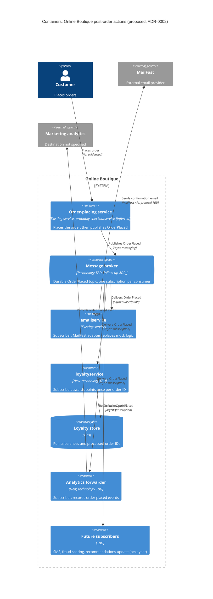

Agent: Claude (Anthropic), fresh agent session; model: claude-opus-5-5 (as configured)

# ADR-0002: Publish an "OrderPlaced" event and handle post-order actions as independent subscribers

- **Status:** Proposed
- **Date:** 2026-10-25
- **Deciders:** Not given (see Open questions)
- **Basis:** Run `a` (zero-shot), context `none`. Written from the requirement text only. No Online Boutique source files were read, so anything said about the current system is marked **[Inferred]** or **[Assumption]**.

## Context and problem

After an order is placed, Online Boutique must do three things (from the requirement):

| # | Post-order action | Component | Status |
|---|---|---|---|
| 1 | Send the order confirmation email through **MailFast**, a new external email provider | existing `emailservice` (its mock logic is replaced) | change |
| 2 | Award **loyalty points** | new `loyaltyservice` | to be built |
| 3 | Record an **"order placed" analytics event** for the marketing team | analytics destination not named | new |

Marketing also expects **more post-order actions next year**: SMS, fraud scoring and a recommendations update. So the number of post-order actions will grow from 3 to at least 6.

Problem: how should the order-placing flow trigger these actions so that (a) adding new actions is cheap, and (b) a slow or failing action, especially the external MailFast, does not slow down or break order placement?

Facts about the current system that this ADR relies on but does not have evidence for:

- **[Inferred]** One service (probably `checkoutservice`) completes the order and currently calls `emailservice` directly and synchronously. Not evidenced in the provided files.
- **[Assumption]** No message broker exists in the system today. Not evidenced in the provided files.
- No numbers were given (order volume, latency budget, availability targets, email delay tolerance). See Open questions.

## Decision drivers

Most important first:

1. **Modifiability / extensibility:** at least 3 more post-order actions are expected next year. Adding one should not mean changing and redeploying the order-placing service.
2. **Availability / fault isolation:** an outage or slowdown in MailFast (external, outside our control), `loyaltyservice` (new, not yet proven) or analytics must not make orders fail.
3. **Performance:** checkout latency should not grow with the number of post-order actions.
4. **Reliability:** every placed order must eventually get its email, points and analytics event. Loyalty points must not be awarded twice for one order.
5. **Vendor isolation:** MailFast is a new external provider. Replacing it later should touch only one component.
6. **Cost and operability:** keep new infrastructure, and the skills needed to run it, proportionate.
7. **Security / privacy:** order events contain customer data (e.g. the email address). Each consumer should get only what it needs.

## Considered options

1. **Option A: synchronous direct calls.** The order-placing service calls `emailservice` (which calls MailFast), `loyaltyservice` and an analytics endpoint one after another (or in parallel) inside the request, and adds one call for each future action.
2. **Option B: event-driven publish/subscribe.** The order-placing service publishes one `OrderPlaced` event to a message broker. `emailservice`, `loyaltyservice` and an analytics forwarder each subscribe independently. Future actions are added as new subscribers.
3. **Option C: dedicated post-order orchestrator.** The order-placing service hands the order to a new orchestrator service, which calls each action in a defined sequence with its own retries and status tracking. Future actions are added to the orchestrator's workflow.

### Pros and cons of the options

| Option | Pros | Cons |
|---|---|---|
| A: Synchronous direct calls | Simplest. No new infrastructure. Errors show up at once in the same request. Easy to trace end to end. Probably matches today's style **[Inferred]**. | Checkout latency grows with every action (the sum of the calls, or the slowest one if run in parallel). Order placement depends on MailFast, `loyaltyservice` and analytics all being up, unless failures are swallowed, and then they are silently lost. Each new action (SMS, fraud, recs) changes and redeploys the order-placing service. Retries against external MailFast happen inside the customer's request. Partial failure (order placed, email failed) needs ad hoc handling. |
| B: Publish/subscribe | The order-placing service publishes once and does not know who consumes the event, so new actions are new subscribers with no change to checkout. The broker buffers events, so a MailFast or `loyaltyservice` outage delays actions but does not fail orders. Checkout latency does not depend on the number of actions. Each consumer scales and is deployed on its own. Events can be replayed (e.g. for analytics backfill). | A new broker to run, secure, monitor and pay for. Actions become eventually consistent: email and points arrive after a delay. At-least-once delivery means every consumer must be idempotent. Tracing across the async boundary is harder. The event schema becomes a shared contract that needs versioning. Publishing reliably after the order is placed (the dual-write problem) must be solved. |
| C: Orchestrator | Workflow logic sits in one place with explicit order and dependencies. This helps if fraud scoring must run before email or points. Retries, compensation and per-order status are centralized and visible. The order-placing service makes only one hand-off. | Every new action still means changing and redeploying the orchestrator, so the modifiability bottleneck moves rather than goes away. A new service to build and operate. The orchestrator is on the path of every post-order action, and if the hand-off is synchronous, checkout depends on it. It tends to become a "god service" coupled to every action's API. |

## Decision

**Choose Option B: event-driven publish/subscribe on an `OrderPlaced` event.**

Why: it is the only option that meets the top three drivers at the same time. A new action is a new subscriber (modifiability). Consumer or MailFast failures stay out of the order path (availability). Checkout latency is independent of the number of actions (performance). Option A fails drivers 1 to 3 as actions grow. Option C meets driver 2 but keeps a central component that must change for every new action (driver 1).

Shape of the decision:

- **Event:** after an order is placed successfully, the order-placing service publishes `OrderPlaced` (versioned, e.g. `v1`). It carries the order ID, which every consumer uses as its **idempotency key**, plus the minimum fields the consumers need. The exact fields are an open question.
- **`emailservice`:** becomes a subscriber. Its mock logic is replaced by a MailFast adapter. MailFast is reached **only** through `emailservice` (an anti-corruption layer), so a later provider change stays inside one service.
- **`loyaltyservice` (new):** a subscriber that awards points once per order ID.
- **Analytics:** a subscriber (a small forwarder, or a broker-native sink) that records the "order placed" event in marketing's analytics destination. The destination is an open question.
- **Future actions (SMS, fraud scoring, recommendations update):** added as new subscribers with no change to the order-placing service.
- **Out of scope for this ADR:** the broker product and its hosting. Choose them in a follow-up ADR, using durable delivery, per-subscriber queues, dead-letter support, team skills and cost as criteria.

## Consequences

- **Positive:** SMS, fraud scoring and the recommendations update can each be added as a new subscriber, with zero changes to the order-placing service. (quality attribute: modifiability)
- **Positive:** order placement keeps working while MailFast, `loyaltyservice` or analytics are down. Their work is buffered and done after they recover. (quality attribute: availability)
- **Positive:** checkout latency is one publish, however many actions there are. (quality attribute: performance)
- **Positive:** MailFast sits behind `emailservice` only, so switching provider is a one-service change. (quality attribute: modifiability / vendor independence)
- **Positive:** each consumer scales and is deployed on its own. (quality attribute: scalability, deployability)
- **Negative:** a new broker must be run, secured, monitored and paid for. (quality attribute: cost, operability)
- **Negative:** email and points are eventually consistent. The confirmation page cannot promise that the email has already been sent. (quality attribute: consistency / usability)
- **Negative:** every consumer must handle duplicate deliveries idempotently. (quality attribute: reliability; development effort)
- **Negative:** debugging one order across async hops is harder. Correlation IDs and tracing are needed. (quality attribute: observability / testability)
- **Negative:** the `OrderPlaced` schema couples all consumers through data, so a breaking change affects all of them. (quality attribute: modifiability)
- **Risks and mitigations:**

| Risk | Mitigation |
|---|---|
| Event lost if the order is placed but publishing fails (dual write) | Transactional outbox if the order-placing service has a store, otherwise publish with retry plus an alert. A reconciliation check compares orders with events. (Depends on Open question 2.) |
| Loyalty points awarded twice | Idempotency on order ID (e.g. a unique constraint on processed order IDs in the loyalty store) |
| MailFast outage or rate limiting | Consumer retries with backoff, a dead-letter queue (DLQ) and an alert. Rate limits are unknown (Open question 7). |
| Poison message blocks a subscription | Maximum retry count, then DLQ, with an alert and a replay procedure |
| Customer data (email address) exposed to consumers that don't need it, e.g. analytics | Minimal event payload. Access control per subscription. Analytics gets only the fields it needs (Open question 12). |
| Fraud scoring next year may need to **gate** email or points | Chain events (fraud scoring publishes e.g. `OrderScored`, and gated actions subscribe to that), or revisit Option C in a new ADR (Open question 10) |
| Team has no experience running a broker | Prefer a managed broker. Run a training spike before rollout (Open question 11). |
| Consumers assume event order | Design each consumer to be correct per order ID, with no ordering across orders |

## Validation

- **Fault-injection test:** stop MailFast (or a stub of it) and `loyaltyservice`, then place orders. Expected: every order succeeds. After recovery, every order gets exactly one email attempt and points awarded exactly once.
- **Duplicate-delivery test:** redeliver the same `OrderPlaced` event. Expected: points are awarded once. Whether a duplicate email is acceptable is Open question 13.
- **Load test:** compare checkout latency (e.g. p95) with 3 subscribers and with extra dummy subscribers against today's baseline. Expected: no meaningful change. The baseline and target are Open question 4.
- **Modifiability check:** add a dummy "SMS" subscriber. Expected: zero changes to the order-placing service's code or deployment.
- **Production metrics:** publish failures, consumer lag per subscription, DLQ depth, time from order to email sent and to points awarded (targets are Open question 6), and MailFast error rate.
- **Review:** when the first of next year's actions (SMS, fraud scoring or recommendations update) is designed, or at a date the deciders set.

## Open questions

1. Which service places the order, and how does it call `emailservice` today (protocol, sync or async)? This ADR assumes `checkoutservice` and synchronous calls **[Inferred]**. Not evidenced in the provided files.
2. Does the order-placing service have a persistent store (needed for a transactional outbox)?
3. What are the order volume and peak throughput?
4. What is the checkout latency budget, and what is today's baseline?
5. What are the availability targets for order placement and for each post-order action?
6. How long may the confirmation email, the loyalty points and the analytics event be delayed after an order?
7. MailFast: what is its API protocol, and what are its rate limits, SLA, idempotency support, bounce and delivery callbacks, cost per email and data-residency terms?
8. Which analytics tool or system does marketing use, and which event fields does it need?
9. What are the loyalty rules (points per order), and what happens to points on cancellation or refund?
10. Must fraud scoring (next year) finish **before** the email or points? If yes, the choice between choreography and orchestration should be revisited.
11. Which broker product and hosting (existing infrastructure is not evidenced)? What broker experience does the team have?
12. What privacy or compliance rules apply to customer data in events (email address, purchased items)?
13. Is an occasional duplicate confirmation email acceptable, or is exactly-once sending required?
14. What budget is available for new infrastructure (broker, MailFast fees)?
15. Who are the deciders for this ADR?
